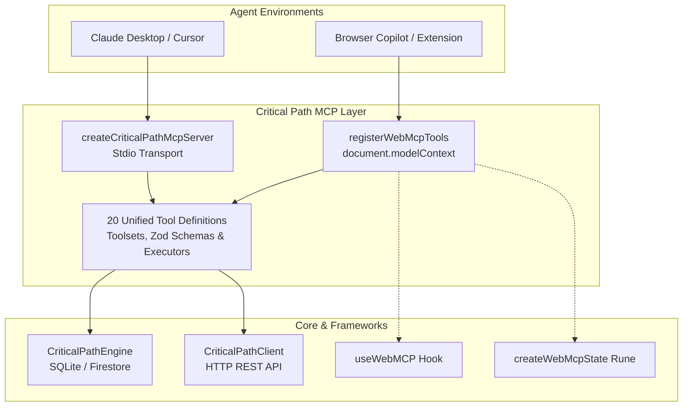

Critical Path provides native, first-class AI integration through the **Model Context Protocol (MCP)** via `@critical-path/mcp`.

Rather than treating AI as an external consumer that must screen-scrape UIs or guess REST endpoints, Critical Path exposes a **unified tool definition registry** that powers two distinct environments:

1. **Standard Server MCP** (`@critical-path/mcp/server`): Stdio or network transport connecting IDE agents (Claude Desktop, Cursor, Antigravity, cline) directly to local SQLite databases or remote Critical Path APIs.
2. **Client-Side WebMCP** (`@critical-path/mcp/web`): In-browser tool registration following the **W3C Web Machine Learning Community Group (WebML CG)** WebMCP specification, enabling browser copilots to interact with project state using ambient project scoping.

Both share the same toolsets, agent instructions and bundled [agent skills](/mcp/agent-discovery/), so agents can find the right tool and follow a proven playbook for multi-step jobs.

---

## 🏛️ Architecture



---

## 🛠️ Complete Tool Registry

`@critical-path/mcp` provides 20 tools in five toolsets. Hosts can expose only the toolsets an agent needs; see [Agent Discovery, Toolsets & Skills](/mcp/agent-discovery/).

| Tool | Toolset | Use it for | Key arguments |
| :--- | :--- | :--- | :--- |
| `list_projects` | core | Finding project ids; returns `{ projects }` | — |
| `get_project` | core | A project's workflow statuses, custom fields and calendar | `id` |
| `create_project` | core | A new, empty project | `name`, `key`, `description` |
| `list_tasks` | core | Finding tasks by project, status, priority, assignee, iteration, deliverable, container or parent; returns `{ tasks, nextCursor }` | `projectId`, `status`, `priority`, `assigneeId`, `parentId`, `limit`, `cursor` |
| `get_task` | core | One task's full record | `id` |
| `create_task` | core | Adding work | `projectId`, `title`, `estimatedHours`, `priority`, `assigneeId` |
| `update_task` | core | Changing status, priority, assignee, estimates, logged hours, blocked state | `id`, plus the fields to change |
| `delete_task` | core | Permanent deletion (destructive) | `id` |
| `list_deliverables` | collaboration | A project's milestones; returns `{ deliverables }` | `projectId` |
| `create_deliverable` | collaboration | A dated milestone grouping tasks | `projectId`, `title`, `dueDate`, `taskIds` |
| `list_comments` | collaboration | A task's discussion; returns `{ comments }` | `taskId` |
| `add_comment` | collaboration | Recording a decision or note (authored by the server's actor) | `taskId`, `content` |
| `calculate_critical_path` | scheduling | Forecast finish, critical tasks, slack, over-allocations | `projectId`, `calendars`, `levelResources`, `effort` |
| `calculate_portfolio_critical_path` | scheduling | Several projects sharing people | `projectIds`, `projectOrder`, `calendars`, `levelResources` |
| `get_workload_distribution` | scheduling | Hours and utilization per person, team or category over time | `projectId`, `groupBy`, `interval`, `metric`, `startDate`, `endDate` |
| `get_timeline_ladder` | analytics | Project status: phase health, timeline, evidence of work | `projectId`, `level` |
| `get_task_ladder` | analytics | One task's phase, schedule position and evidence | `taskId` |
| `get_task_metrics` | analytics | Progress, variance and earned value (CPI, SPI) for a task | `taskId` |
| `get_task_progress_history` | analytics | Progress over time and curve shape (stalled, late rush, ...) | `taskId` |
| `get_skill` | guidance | Loading a playbook for a multi-step job | `name` |

Every tool declares an `outputSchema` and returns structured content, and every tool sends the standard MCP annotations (`readOnlyHint`, `destructiveHint`, `idempotentHint`, `openWorldHint`).

---

## 🎯 Ambient Project Scoping

When building frontend applications (e.g. viewing a project dashboard at `/projects/design-system`), user agents should not have to ask the user "Which project ID are you referring to?".

WebMCP supports **ambient scoping**:
```ts
registerWebMcpTools({
  client,
  projectId: 'proj_marketing_q3', // Ambient context
  tools: ['create_task', 'list_tasks']
});
```
When an LLM calls `create_task({ title: "Draft banner copy" })`, `projectId` is automatically resolved and injected without requiring the model to specify it.

---

## 📦 Installation

```bash
# Add to your project or monorepo
pnpm add @critical-path/mcp
```

- When using in server environments or Node CLIs, import from `@critical-path/mcp` or `@critical-path/mcp/server`.
- When bundling for the browser (Vite, Next.js client, SvelteKit), import from `@critical-path/mcp/web` to avoid bundling Node stdio transports.
